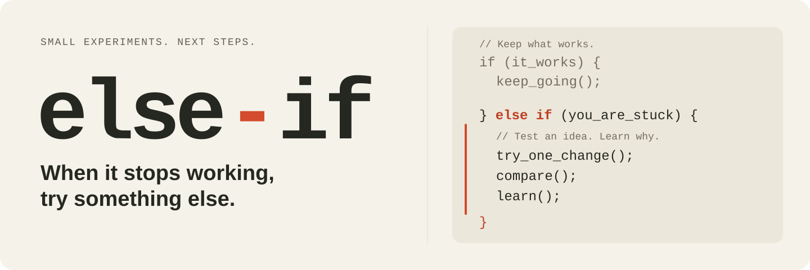

# else-if



한국어 · [English](README.en.md)

**같은 시도를 반복하고 있다면, 다음에 무엇을 바꿔볼지 정하세요.**

else-if는 막힌 프로젝트에서 원인 가설을 나누고, 작은 비교 실험 하나를 골라 결과로 다음 행동을 정하는 **Agent Skills 형식의 AI 스킬**입니다.

예를 들어 “디자인을 여러 번 고쳐도 원하는 느낌이 안 난다”면, 요청 전달·화면 구성·원본 이미지 중 무엇부터 확인할지 좁힙니다. 이전 결과와 새 결과를 비교하고, 사용자 피드백에 따라 유지할 부분과 다음에 바꿀 부분을 정합니다. 이 예시는 사용 흐름의 설명이며 개선 효과를 보장하지 않습니다.

## 이런 상황에 사용하세요

- 수정과 재시도가 반복되는데 무엇이 문제인지 불분명할 때
- 여러 접근 중 무엇부터 시험해야 할지 정하기 어려울 때
- 조금 나아진 결과에서 무엇을 유지하고 무엇을 바꿀지 판단할 때

단순한 오류 수정이나 이미 방법이 정해진 구현에는 기존 작업 흐름을 사용하면 됩니다.

## 어떻게 작동하나요?

**문제와 근거 확인 → 후보 최대 3개 → 하나 추천 → 작은 비교 → 결과 회고**

- 사용자가 원하는 대상·범위·방향을 먼저 맞춥니다.
- 이전 결과물을 남겨 새 결과물과 직접 비교합니다.
- 기술 수치, 제작자의 자기평가, 사용자 반응을 구분합니다.
- 같은 불만이 남으면 미세 조정을 반복하기보다 다른 원인 가설을 검토합니다.
- 부분적인 긍정을 전체 성공이나 배포 승인으로 확대하지 않습니다.

| 구성 | 역할 | 사용 시점 |
| --- | --- | --- |
| 스킬 | 대화에서 가설·실험·회고를 진행 | 기본 사용 |
| 이어가기 훅 | 저장된 실험 상태를 후속 대화에 다시 전달 | 긴 대화에서 선택적으로 설치 |
| 정량 비교 도구 | 고정한 계획과 제출된 수치를 비교 | 수치로 평가할 때만 사용 |

일상적인 상담에 JSON 파일이나 실험 양식을 직접 작성할 필요는 없습니다. AI는 현재 사용하는 호스트의 모델과 도구를 사용합니다.

## 지원 범위

| 환경 | 기본 스킬 | 자동 이어가기 | 확인 범위 |
| --- | --- | --- | --- |
| Codex 로컬 환경 | `$else-if` | 선택적 훅 | 이벤트·설치·격리 자동 테스트, 기존 실사용 피드백. 개정 버전의 실제 모델 대화는 미검증 |
| Claude Code 로컬 환경 | `/else-if` | 선택적 훅 | 공식 입출력 규격·설정 보존·설치 명령·다회차 상태 테스트. 실제 모델 대화는 미검증 |
| 파일·실행 도구가 없는 채팅 | 지침을 제공해 수동 사용 | 제공하지 않음 | 짧은 진행 요약을 대화로 전달 |
| Gemini CLI 로컬 환경 | `else-if: …` 일반 메시지로 스킬 사용 요청 | 선택적 훅 | 공식 이벤트·설정 보존·명령 실행 테스트. 실제 CLI·모델 대화는 미검증 |
| 그 외 호스트 | 전용 설치·호환성 미검증 | 미지원 | 수동 지침 사용 가능 |

스킬 파일 형식과 훅 호환성은 별개입니다. Claude Code의 로컬 설치 안내를 Claude 웹·Cowork·클라우드 세션 지원으로 해석하지 마세요. [Agent Skills 규격](https://agentskills.io/specification)

## 빠른 시작

### 1. 스킬 설치

Codex, Claude Code 또는 Gemini CLI와 Git이 필요합니다. 아래 명령은 macOS·Linux의 POSIX 셸 기준입니다. Python 보조 도구와 훅에는 **Python 3.9 이상**이 필요하며, 추가 Python 패키지나 별도 API 키는 필요하지 않습니다. 현재 자동 테스트는 macOS / Python 3.11에서 확인했습니다.

```sh
git clone https://github.com/Raunplaymore/else-if.git
cd else-if
```

**Codex:**

```sh
mkdir -p "${CODEX_HOME:-$HOME/.codex}/skills"
ln -s "$PWD/skills/else-if" "${CODEX_HOME:-$HOME/.codex}/skills/else-if"
```

**Claude Code:**

```sh
mkdir -p "${CLAUDE_CONFIG_DIR:-$HOME/.claude}/skills"
ln -s "$PWD/skills/else-if" "${CLAUDE_CONFIG_DIR:-$HOME/.claude}/skills/else-if"
```

**Gemini CLI:**

```sh
mkdir -p "$HOME/.gemini/skills"
ln -s "$PWD/skills/else-if" "$HOME/.gemini/skills/else-if"
```

같은 이름의 스킬이 있으면 링크 생성이 실패하며 기존 내용을 덮어쓰지 않습니다. 설치한 저장소는 그대로 유지하세요. 이동하거나 삭제하면 링크가 끊어집니다.

### 2. 프로젝트에서 호출

작업할 프로젝트의 Codex 대화에서 `$else-if`, Claude Code에서 `/else-if`로 시작합니다. 기본 스킬은 훅 없이도 사용할 수 있습니다.

```text
$else-if 디자인을 여러 번 수정했는데 방향이 계속 어긋난다.
요청과 결과, 피드백을 보고 다음에 무엇을 시험할지 추천해 줘.
```

Claude Code 예시:

```text
/else-if 같은 디자인을 계속 고쳐도 방향이 어긋나. 다음 비교 실험을 추천해 줘.
```

Gemini CLI에서는 일반 메시지로 요청하고 Gemini가 표시하는 스킬 활성화 동의를 확인하세요. `else-if:`는 이 프로젝트의 이어가기 시작 표시이며 Gemini의 기본 슬래시 명령이 아닙니다. `/skills list`에서 스킬이 보이는지 확인할 수 있습니다.

```text
else-if: else-if 스킬을 사용해 줘. 디자인 수정이 반복되는데 다음에 무엇을 비교할지 추천해 줘.
```

후속 요청은 자연스럽게 이어가면 됩니다.

```text
첫 번째 실험으로 해보자. 30분, 추가 지출 없이 비교해 줘.
```

```text
색만 바뀐 느낌이야. 배치까지 바꾸는 방향으로 다시 검토해 줘.
```

첫 호출이 인식되지 않으면 새 대화에서 시도하거나 사용 중인 호스트를 다시 시작하세요. 현재 대화에서는 내려받은 `skills/else-if/SKILL.md`의 절대 경로를 주고 해당 스킬을 읽어 사용해 달라고 요청할 수도 있습니다.

## 선택: 대화 이어가기 훅

긴 대화에서는 현재 실험이 무엇인지 흐려질 수 있습니다. 훅은 목표·가설·직전 결과·다음 행동·현재 단계를 저장하고, 다음 메시지나 대화 재개·맥락 압축 후 다시 전달합니다. Gemini에서는 압축 직후 같은 실행 중의 복구 대신 다음 사용자 입력에서 상태를 다시 전달합니다.

### 설치와 신뢰 확인

내려받은 **else-if 저장소 루트**에서 실행합니다.

```sh
# 설치할 호스트 하나를 선택하세요.
python3 scripts/install_continuity.py --host codex
# Claude Code라면 위 명령 대신:
# python3 scripts/install_continuity.py --host claude
# Gemini CLI라면:
# python3 scripts/install_continuity.py --host gemini
```

설치기는 선택한 호스트의 사용자 설정을 백업하고 else-if 항목만 추가합니다. Codex는 `hooks.json`, Claude Code와 Gemini CLI는 각각의 `settings.json`을 사용합니다. Codex·Claude는 `UserPromptSubmit`와 `SessionStart`, Gemini는 `BeforeAgent`와 `SessionStart` 두 이벤트에 등록합니다. 기존 훅은 유지하며 신뢰 설정을 변경하지 않습니다.

**호스트의 활성화 절차를 확인하세요.** Codex는 `/hooks`에서 새 항목 두 개를 검토하고 신뢰 처리해야 합니다. Claude Code에서는 `/hooks`에 두 항목이 표시되는지 확인하고 해당 작업 폴더의 신뢰·권한 규칙을 따르세요. Gemini CLI에서는 `/hooks panel`에서 `else-if-continuity-BeforeAgent`와 `else-if-continuity-SessionStart`를 확인하고 비활성 상태라면 해당 항목만 활성화하세요. 스킬 활성화 동의와 훅 설정은 별개입니다. 표시되지 않으면 호스트를 다시 시작하세요. [Codex 훅](https://learn.chatgpt.com/docs/hooks#review-and-trust-hooks) · [Claude Code 훅](https://code.claude.com/docs/en/hooks) · [Gemini 훅](https://geminicli.com/docs/hooks/reference/)

설정 등록 여부는 다음 명령으로 확인할 수 있습니다. 실제 호출·신뢰·준수를 증명하는 검사는 아닙니다.

```sh
python3 scripts/install_continuity.py --host codex --check
# Claude Code라면 --host claude, Gemini CLI라면 --host gemini
```

### 사용과 종료

활성화 확인 후 **메시지 맨 앞에** Codex에서는 `$else-if`, Claude Code에서는 `/else-if`, Gemini CLI에서는 `else-if:`를 써서 시작합니다. 시작·단계 변경·복구 시에는 `else-if · 결과 검토`처럼 현재 단계를 짧게 표시하도록 스킬에 지시합니다. 이 표시는 지침 준수 인증이 아닙니다.

종료하려면 다음 내용을 메시지 전체로 보냅니다.

```text
$else-if 종료
```

Codex는 `$else-if stop`도 사용할 수 있습니다. Claude Code에서는 `/else-if 종료` 또는 `/else-if stop`을 사용합니다. Gemini CLI에서는 `else-if: 종료` 또는 `else-if: stop`을 메시지 전체로 보냅니다. 이 명령은 해당 대화의 체크포인트만 삭제하며 실험 결과물은 남깁니다. 자연어 종료나 다른 작업으로의 전환은 에이전트가 해제합니다. 단순 언급·인용문은 훅을 활성화하지 않습니다. 자연어로 스킬을 호출한 경우에는 에이전트가 상태를 저장해 이어가기를 시작할 수 있습니다.

### 기록과 한계

- 기록은 작업 중인 프로젝트의 `next-experiment-runs/.else-if-sessions/`에 대화별로 저장합니다. Claude Code와 Gemini CLI는 그 아래 각각 `claude/`, `gemini/`로 분리되어 같은 대화 ID라도 Codex 상태와 섞이지 않습니다. 전체 대화나 다른 프로젝트를 수집하지 않습니다.
- 새 대화·분기·다른 작업 폴더에는 자동 승계하지 않습니다.
- 상태 갱신은 에이전트가 담당합니다. 훅이 실행돼도 오래된 상태가 전달될 수 있고, 지침 준수까지 보장하지는 않습니다.
- 별도 AI 호출·응답 차단·자동 재실행·백그라운드 감시는 없습니다. 전달하는 맥락은 호스트 모델 사용량에 포함될 수 있습니다.

에이전트에 “else-if의 상태와 마지막 훅 호출 시각을 확인해 줘”라고 요청하면 현재 호스트·대화 ID로 `continuity.py status`를 실행할 수 있습니다. `updated_at`은 내용 갱신 시각, `last_hook`은 마지막 호출 기록입니다. 수동 저장만 했다면 `last_hook`은 비어 있습니다. Codex의 기존 버전 1 기록은 계속 읽을 수 있습니다.

자세한 저장·복구 절차는 [이어가기 지침](skills/else-if/references/continuity.md)에 있습니다.

## 선택: 수치로 결과 비교

계획과 결과를 JSON으로 기록한 경우에는 다음 도구를 사용할 수 있습니다. 아래 파일은 **전부 합성 예시**이며 실제 프로젝트 성과가 아닙니다. 저장소 루트에서 실행하세요.

```sh
python3 skills/else-if/scripts/experiment.py check examples/design-plan.json
python3 skills/else-if/scripts/experiment.py review examples/design-plan.json examples/design-results.json
```

`check`는 계획의 형식과 지문을 확인합니다. `review`는 같은 계획에 연결된 기준선·후보 측정값을 비교하며, 누락·실패·조건 변경·예산 초과를 반영합니다. 예시 결과는 `criteria_met`입니다. 제출된 수치가 정한 조건을 충족한다는 의미이며, 인과관계·통계적 효과·출처의 진위를 입증하지 않습니다. 예산을 실시간으로 차단하는 기능도 없습니다.

입력 계약은 [기록 형식](skills/else-if/references/record-format.md)을 참고하세요. 비교 도구는 지정한 두 입력 파일만 읽으며 네트워크·명령 실행·파일 쓰기를 수행하지 않습니다.

테스트:

```sh
python3 -m unittest discover -s tests -v
```

## 업데이트·비활성화·제거

업데이트는 else-if 저장소에서 `git pull --ff-only`로 받습니다. 훅 실행 명령이나 정의가 바뀐 경우 설치기를 다시 실행하고 해당 호스트에서 새 검토·신뢰 확인이 필요한지 확인하세요.

Codex에서 자동 스킬 선택을 끄려면 `skills/else-if/agents/openai.yaml`에 다음을 추가합니다. 명시적인 `$else-if` 호출은 유지됩니다. 이미 활성화된 이어가기를 멈추려면 별도로 `$else-if 종료`를 보내세요.

```yaml
policy:
  allow_implicit_invocation: false
```

Claude Code·Gemini CLI의 자동 선택·권한 제어는 해당 호스트의 설정을 따릅니다. 위 `agents/openai.yaml` 정책은 Codex용입니다.

제거는 else-if 저장소 루트에서 진행합니다. 훅을 설치했다면 먼저 else-if 훅만 제거한 다음 스킬 링크를 해제합니다.

```sh
python3 scripts/install_continuity.py --host codex --remove
test -L "${CODEX_HOME:-$HOME/.codex}/skills/else-if" && unlink "${CODEX_HOME:-$HOME/.codex}/skills/else-if"
```

Claude Code 제거:

```sh
python3 scripts/install_continuity.py --host claude --remove
test -L "${CLAUDE_CONFIG_DIR:-$HOME/.claude}/skills/else-if" && unlink "${CLAUDE_CONFIG_DIR:-$HOME/.claude}/skills/else-if"
```

Gemini CLI 제거:

```sh
python3 scripts/install_continuity.py --host gemini --remove
test -L "$HOME/.gemini/skills/else-if" && unlink "$HOME/.gemini/skills/else-if"
```

해당 호스트에서 설정을 다시 불러오세요. 이미 대화에 읽힌 지침은 제거만으로 사라지지 않으므로 사용 중단을 요청하거나 새 대화를 시작하세요. 프로젝트의 `next-experiment-runs/` 기록과 사용자 설정 폴더의 훅 백업 파일은 자동 삭제하지 않습니다.

## 제공 범위

현재 버전은 스킬과 보조 도구입니다. 별도 앱·자체 모델·자동 실험 실행기·정책 자동 적용은 제공하지 않습니다. 실험 수행은 사용자가 요청한 범위에서 사용 중인 호스트의 기존 도구로 진행합니다.

일부 실사용에서 개선 방향을 구체화하고 비교를 이어가는 데 도움이 됐다는 피드백을 받았습니다. 일반적인 성능 향상이나 디자인 품질 보장으로 검증된 것은 아닙니다. 전달한 자료에는 호스트의 데이터 처리 정책이 적용되며, 스킬 사용은 호스트 구독·모델 사용량을 소비할 수 있습니다.

여러 차례 이어지는 실제 모델 대화의 검증 시나리오와 미검증 범위는 [행동 검증 안내](tests/BEHAVIORAL.md)에 있습니다.
